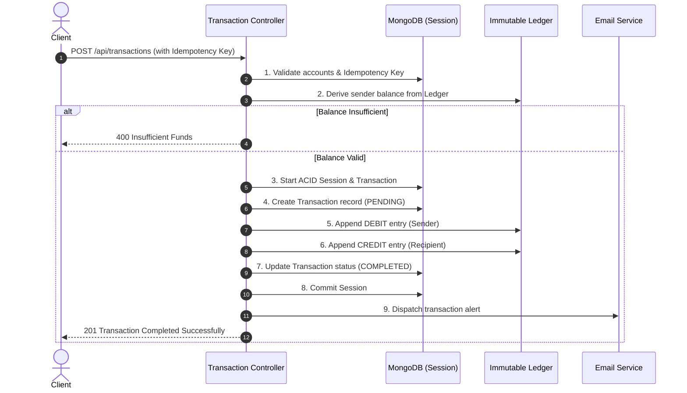

# 🛡️ VaultX — Core Banking & Double-Entry Ledger System

[](https://react.dev)
[](https://nodejs.org)
[](https://expressjs.com)
[](https://mongodb.com)
[](LICENSE)

> **Your Money. Our Vault.** — A production-grade **Core Banking & Double-Entry Ledger System** built with **React, Node.js, Express, and MongoDB**.

Architected around real-world fintech compliance standards, **VaultX** eliminates race conditions, prevents double-spending, and guarantees absolute financial auditability through immutable ledger accounting and atomic ACID transactions.

---

## 🌟 High-Level Industry Concepts Implemented

### 1. 📖 Double-Entry Bookkeeping Engine
Unlike naive banking apps that simply increment or decrement a single `balance` column, **VaultX adheres to the fundamental accounting equation**:
$$\text{Total Debits} = \text{Total Credits}$$
Every financial transfer atomically generates two synchronized records in the ledger:
* **DEBIT** entry on the sender's account
* **CREDIT** entry on the recipient's account

### 2. 🔒 Immutable Append-Only Ledger
Financial data must never be overwritten or deleted.
* Enforced at the database level via MongoDB pre-hooks blocking `updateOne`, `findOneAndUpdate`, `deleteOne`, `deleteMany`, and `findOneAndReplace`.
* The ledger is strictly **append-only**. Any correction or refund requires creating a countervailing reversal entry rather than altering historic rows.

### 3. ⚡ ACID Multi-Document Transactions & Atomicity
* Uses **MongoDB Sessions & Transactions** (`startSession()`, `startTransaction()`, `commitTransaction()`).
* If any step in the multi-step transaction pipeline fails (insufficient funds, network timeout, service crash), the entire transaction aborts without leaving money in an orphaned or inconsistent state.

### 4. 🛡️ Idempotency Key Guarantees
* Prevents duplicate transactions caused by accidental double-clicks, network timeouts, or client retries.
* Every transfer requires an `idempotencyKey`. If a duplicate key is submitted, the system returns the cached status of the original transaction without reprocessing financial movements.

### 5. 🧮 Dynamically Derived Balances
* An account's available balance is dynamically computed by aggregating historic ledger movements:
$$\text{Balance} = \sum(\text{Credits}) - \sum(\text{Debits})$$
* This completely eliminates balance tampering or discrepancy bugs between stored balances and transaction history.

### 6. 🔐 Secure JWT Auth with Token Blacklisting
* Stateless JWT authentication backed by a persistent **Blacklist Model** with MongoDB TTL (Time-To-Live) auto-expiration.
* Ensures true logout and immediate revocation of compromised tokens.

### 7. 📬 Transactional Email Notifications
* Automated transactional emails triggered upon successful settlement to maintain customer communication and audit trails.

---

## 🏗️ System Architecture & 10-Step Transfer Flow



---

## 📂 Repository Structure

```text
VaultX-Banking-System/
├── backend/
│   ├── src/
│   │   ├── config/         # Database connection (MongoDB)
│   │   ├── controllers/    # Business logic (Auth, Account, Transaction)
│   │   ├── middleware/     # JWT authentication & Token Blacklist verification
│   │   ├── models/         # Schemas (User, Account, Transaction, Ledger, BlackList)
│   │   ├── routes/         # Express API route declarations
│   │   └── services/       # Email notification services
│   ├── server.js           # Server bootstrap
│   └── package.json        # Backend dependencies
├── frontend/
│   ├── src/                # Modern React client application
│   └── package.json        # Frontend dependencies
└── README.md
```

---

## 🔌 Core API Endpoints

### 🔑 Authentication
| Method | Endpoint | Description |
| :--- | :--- | :--- |
| `POST` | `/api/auth/register` | Register a new user |
| `POST` | `/api/auth/login` | Login and obtain JWT |
| `GET` | `/api/auth/me` | Get authenticated user profile |
| `POST` | `/api/auth/logout` | Invalidate token via Blacklist |

### 💳 Accounts
| Method | Endpoint | Description |
| :--- | :--- | :--- |
| `POST` | `/api/accounts` | Create a new multi-currency banking account (`INR`, `USD`, `EUR`, `GBP`) |
| `GET` | `/api/accounts` | List logged-in user's accounts with live balances |
| `GET` | `/api/accounts/lookup?query=` | Find active recipient accounts by email or Account ID |
| `GET` | `/api/accounts/balance/:accountId` | Derive real-time balance from ledger |
| `PATCH` | `/api/accounts/:accountId/status` | Freeze or activate an account (`ACTIVE` / `FROZEN`) |

### 💸 Transactions, Ledger & Health
| Method | Endpoint | Description |
| :--- | :--- | :--- |
| `GET` | `/api/health` | Check core engine & MongoDB connection health |
| `GET` | `/api/transactions` | Fetch transaction history / passbook |
| `GET` | `/api/transactions/ledger` | Fetch immutable double-entry DEBIT/CREDIT ledger logs |
| `POST` | `/api/transactions` | Execute atomic money transfer |
| `POST` | `/api/transactions/system/initial-funds` | Fund an account with initial balance (System User) |

---

## 🚀 Getting Started

### Prerequisites
* [Node.js](https://nodejs.org/) (v18+)
* [MongoDB](https://www.mongodb.com/) (Replica Set required for Transactions, or MongoDB Atlas)

### 1. Clone the repository
```bash
git clone https://github.com/vishalkumar2501/VaultX-Banking-System.git
cd VaultX-Banking-System
```

### 2. Backend Setup
```bash
cd backend
npm install
```

Create a `.env` file in the `backend/` folder:
```env
PORT=3000
MONGO_URI=your_mongodb_connection_string
JWT_SECRET=your_jwt_secret_key
EMAIL_USER=your_email@gmail.com
EMAIL_PASS=your_email_app_password
```

Start the backend:
```bash
npm run dev # or node server.js
```

### 3. Frontend Setup
```bash
cd ../frontend
npm install
npm run dev
```

Open `http://localhost:5173` — switch seamlessly between **Dark Mode** and **Light Mode** directly from the navbar.

---

## 👨‍💻 Author
**Vishal Kumar**
* GitHub: [@vishalkumar2501](https://github.com/vishalkumar2501)

---

## 📄 License
This project is licensed under the MIT License.
