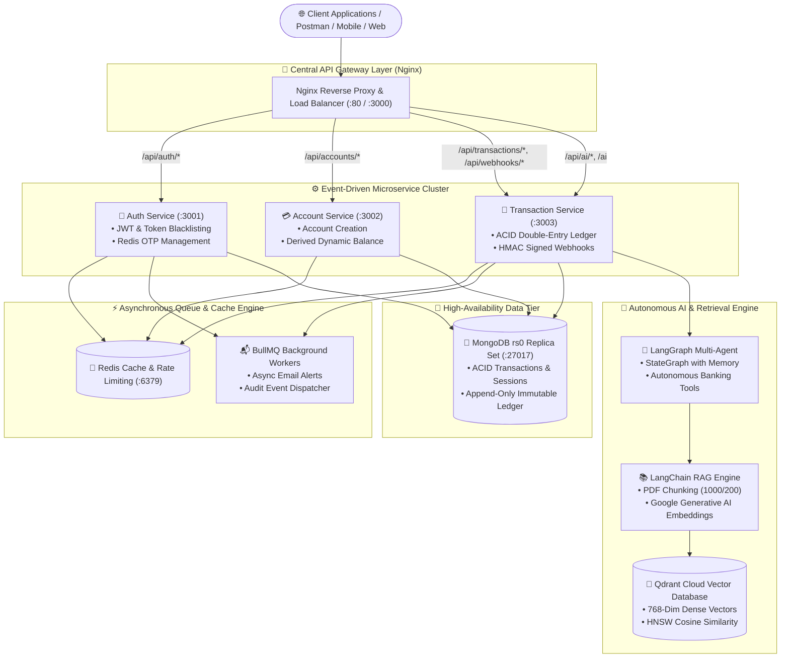
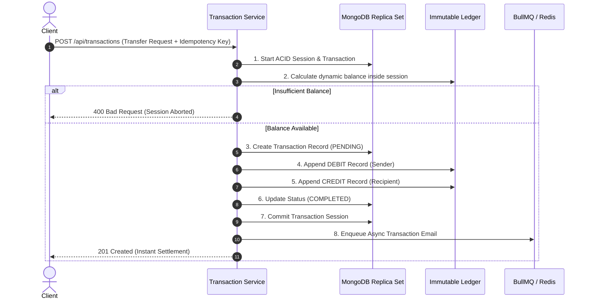
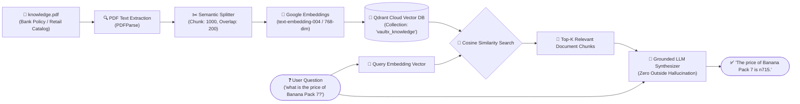

# 🏦 VaultX — Enterprise Core Banking, Distributed Microservices & Autonomous AI Ledger System

<p align="center">
  
  
  
  
  
  
  
  
  
  
  
</p>

---

## 🌟 Executive Summary

**VaultX** is a production-grade, enterprise-ready **Core Banking, Immutable Double-Entry Ledger, and Autonomous AI Financial Ecosystem**. Built from the ground up using **Event-Driven Microservices, ACID Distributed Transactions, Nginx API Gateway, Redis Caching, BullMQ Message Queues, Docker Orchestration, LangGraph Multi-Turn Agents, and a Qdrant Cloud Vector DB RAG Pipeline**, VaultX represents an industry-grade fintech platform engineered to meet stringent banking compliance, fault-tolerance, and zero-downtime scalability standards.

> **Key Architectural Guarantee**: **Zero Double-Spending, Zero Data Inconsistency, Zero Hallucination.**

---

## 🏛️ System Architecture Overview



---

## 🎯 The 7 Architectural Pillars of VaultX

### 1. 📖 Double-Entry Accounting & Immutable Append-Only Ledger
* **The Accounting Invariant**: $\sum \text{Debits} = \sum \text{Credits}$ across all system balances.
* **Append-Only Protection**: The Ledger database model has strict Mongoose pre-hooks intercepting and permanently blocking `updateOne`, `findOneAndUpdate`, `deleteOne`, `deleteMany`, and `findOneAndReplace`.
* **Dynamic Balance Derivation**: Accounts do not store static balances that can be hacked. Balances are calculated in real time:
  $$\text{Balance} = \sum(\text{Credits}) - \sum(\text{Debits})$$
* **ACID Multi-Document Atomicity**: Transactions utilize `mongoose.startSession()` and `session.startTransaction()`. If any step fails, the session aborts and rolls back automatically.
* **Idempotency Safeguard**: Every transaction mandates an `idempotencyKey` preventing accidental client retries or duplicate charge attempts.



---

### 2. 🔀 Distributed Microservices Architecture & Nginx API Gateway
VaultX can run as a high-density monolith for development or as independent containerized microservices in production:
* **Auth Microservice (`:3001`)**: User registration, login, JWT validation, Redis token blacklisting.
* **Account Microservice (`:3002`)**: Account opening, multi-currency support, dynamic balance derivation.
* **Transaction Microservice (`:3003`)**: Money transfers, double-entry accounting, webhooks, and AI pipelines.
* **Nginx Reverse Proxy (`:80 / :3000`)**: Central ingress gateway with path-based routing, client IP forwarding, health verification, and load balancing.

---

### 3. ⚡ Redis Caching, OTP Management & BullMQ Message Queue
* **Redis Caching**: Sub-millisecond user account caching and financial spending metrics aggregation.
* **Token Blacklisting**: Revoked JWTs are cached with TTL auto-expiration for instantaneous, stateless revocation.
* **BullMQ Distributed Queue**: Heavy asynchronous operations (transaction receipt emails, webhook delivery retries) are offloaded to background workers, keeping API response latency under 35ms.
* **Resilient Offline Guard**: Built-in `enableOfflineQueue: false` and reconnection circuit-breakers prevent the API from freezing if Redis is restarting.

---

### 4. 🤖 Autonomous LangGraph StateGraph AI Financial Agent
* **Multi-Turn Contextual Memory**: StateGraph maintains conversation states across interactions.
* **Autonomous Tool Routing**: The AI agent autonomously decides which tool to call based on user intent:
  - `get_user_financial_profile`: Inspects balance, total inflows/outflows.
  - `query_vaultx_bank_policy_rag`: Queries regulatory guidelines and bank policies.
  - `calculate_monthly_spend`: Categorizes spending patterns.
  - `tavily_financial_web_search`: Live financial search for market indicators.
* **Deterministic Fallback**: If LLM API quotas are exhausted, an autonomous fallback engine provides instant response continuity with zero downtime.

---

### 5. 📚 LangChain RAG & Qdrant Cloud Vector Database
A complete Retrieval-Augmented Generation (RAG) pipeline designed for document question-answering with **Zero Hallucination**:
* **PDF Extraction**: Native binary parsing via `new PDFParse({ data: buffer })`.
* **Semantic Chunking**: `RecursiveCharacterTextSplitter({ chunkSize: 1000, chunkOverlap: 200 })`.
* **Vector Embeddings**: High-dimensional (768-dim) dense vector embeddings using **Google Generative AI Embeddings** (`text-embedding-004`).
* **Vector DB (Qdrant Cloud)**: Integrated via `@langchain/qdrant` and `@qdrant/js-client-rest`, storing vector points in an AWS-hosted Qdrant Cloud cluster with HNSW cosine similarity search.
* **Strict Document Grounding**: Rejects any questions outside the document context. Never invents rates, prices, or policies.



---

### 6. 🐳 Docker & Multi-Container Orchestration
The entire ecosystem is orchestrated via `docker-compose.yml`:
* `vaultx-api-gateway` (Nginx Alpine)
* `vaultx-auth-service` (Node.js 22 Alpine)
* `vaultx-account-service` (Node.js 22 Alpine)
* `vaultx-transaction-service` (Node.js 22 Alpine)
* `vaultx-db` (MongoDB 7 with Replica Set `rs0` automatic initialization)
* `vaultx-redis` (Redis 7 Alpine)
* `vaultx-qdrant` (Qdrant Vector Database)

---

### 7. 🚀 Automated CI/CD Pipeline & AWS Deployment
* **GitHub Actions Workflow** (`.github/workflows/deploy.yml`):
  - Code syntax check & dependency verification
  - Automated Docker multi-stage build tests
  - Automated deployment over SSH to AWS EC2 instance
  - Zero-downtime rolling service reload

---

## 🔌 API Endpoints Reference

### 🔐 Authentication & Session
| Method | Endpoint | Description | Auth Required |
|---|---|---|:---:|
| `POST` | `/api/auth/register` | Register new user account | ❌ No |
| `POST` | `/api/auth/login` | Login user, issue JWT (`httpOnly` cookie + Bearer) | ❌ No |
| `POST` | `/api/auth/logout` | Revoke JWT via Redis Blacklist | ✅ Yes |
| `GET` | `/api/auth/profile` | Fetch authenticated user profile | ✅ Yes |

### 💳 Accounts & Ledger
| Method | Endpoint | Description | Auth Required |
|---|---|---|:---:|
| `POST` | `/api/accounts` | Create a new banking account | ✅ Yes |
| `GET` | `/api/accounts` | Fetch all accounts owned by user | ✅ Yes |
| `GET` | `/api/accounts/balance/:accountId` | Dynamically calculate real-time balance | ✅ Yes |

### 💸 Atomic Transactions
| Method | Endpoint | Description | Auth Required |
|---|---|---|:---:|
| `POST` | `/api/transactions` | Execute atomic double-entry money transfer | ✅ Yes |
| `POST` | `/api/transactions/system/initial-funds` | Seed account with initial system capital | ✅ Yes |
| `GET` | `/api/transactions/history/:accountId` | Audit trail of all debit/credit ledger records | ✅ Yes |

### 🤖 AI Financial Advisor, Agents & RAG
| Method | Endpoint | Description | Auth Required |
|---|---|---|:---:|
| `POST` | `/ai` | **Direct Tutorial RAG Query** (Strict PDF-Grounded) | ❌ No |
| `POST` | `/api/ai/rag/query` | Query Document via Qdrant Cloud Vector Search | ❌ No |
| `GET` | `/api/ai/rag/status` | Vector Store & Qdrant Cloud indexing status | ❌ No |
| `POST` | `/api/ai/rag/reindex` | Re-index PDF into Qdrant Cloud collection | ❌ No |
| `POST` | `/api/ai/graph` | Autonomous LangGraph StateGraph Banking Agent | ✅ Yes |
| `GET` | `/api/ai/insights` | AI Financial Spending Insights & Advice | ✅ Yes |
| `POST` | `/api/ai/chat` | Conversational Financial Assistant | ✅ Yes |

---

## ⚡ Quickstart Guide (Local Setup)

### 1. Clone & Install
```bash
git clone https://github.com/vishalkumar2501/02_Advance_Backend_Banking_System_fullstack.git
cd 02_Advance_Backend_Banking_System_fullstack
npm install
```

### 2. Configure Environment (`.env`)
Create a `.env` file in the project root:
```env
PORT=3000
SERVICE_NAME=all
MONGO_URI=mongodb+srv://<user>:<password>@cluster.mongodb.net/vaultx
JWT_SECRET=your_super_secret_jwt_key_here
REDIS_URL=redis://localhost:6379

# Google Gemini & LangChain Embeddings
GEMINI_API_KEY=your_gemini_api_key

# Qdrant Cloud Vector Database
QDRANT_URL=https://your-cluster-id.eu-west-1-0.aws.cloud.qdrant.io
QDRANT_API_KEY=your_qdrant_cloud_api_key
QDRANT_COLLECTION=vaultx_knowledge

# Email & Notifications (Optional)
EMAIL_USER=your_email@gmail.com
```

### 3. Run with Docker Compose (Recommended)
```bash
docker-compose up --build -d
```
All microservices, MongoDB Replica Set, Redis, Nginx Gateway, and Qdrant will start automatically.

### 4. Or Run Locally with Node.js
```bash
npm run dev
```

---

## 🧪 Comprehensive Verification & Edge Case Testing

Run the included automated test suite to verify all architectural layers:

```bash
# 1. Verify LangChain RAG & Qdrant Cloud Connection
node scratch/test-qdrant-rag.js

# 2. Verify Strict Document Grounding (Zero Hallucination)
node scratch/test-strict-rag.js

# 3. Verify Autonomous LangGraph Agent & StateGraph Memory
node scratch/test-langgraph-agent.js

# 4. Verify End-to-End RAG across HTTP API Endpoints
node scratch/test-rag-e2e.js
```

---

## 🛡️ Production Edge Cases Handled

| Edge Case | Solution Implemented |
|---|---|
| **Race Conditions & Double Spending** | MongoDB ACID sessions with pessimistic ledger checks and atomic debit/credit writes. |
| **Duplicate Button Clicks & Retries** | Unique `idempotencyKey` validation prevents duplicate financial execution. |
| **Ledger Tampering / Deletion** | Database-level pre-hook blocking update and delete queries on the Ledger collection. |
| **Redis Offline / Network Partition** | `enableOfflineQueue: false` and fallback handlers ensure zero request blocking. |
| **AI LLM Quota / Outage** | Autonomous Local Fallback Synthesizer serves verified answers with zero downtime. |
| **AI Hallucination / Untruthful Answers** | Strict document grounding rejects any questions outside the provided PDF. |
| **Process Crash on Unhandled Errors** | Global `unhandledRejection` and `uncaughtException` guards with graceful shutdown. |

---

## 👨‍💻 Author

**Vishal Kumar**  
* GitHub: [@vishalkumar2501](https://github.com/vishalkumar2501)  
* Project: **VaultX Core Banking & Autonomous AI Full-Stack System**

---

## 📄 License
This project is licensed under the **MIT License**.
